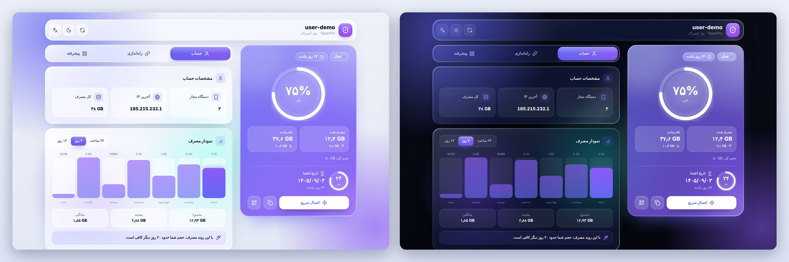

<div align="center">

# TeperPro

**قالب صفحه‌ی اشتراک روشن، تمیز و حرفه‌ای (تب‌دار) برای [Pasarguard](https://github.com/PasarGuard/panel)**

Clean, tabbed, modern subscription page for Pasarguard




</div>

## ✨ امکانات

- طراحی **Aurora**: پس‌زمینه‌ی شیشه‌ای و رنگی، کارت‌های نرم، پوسته‌ی **روشن و تیره** و سه تب: **حساب**، **راه‌اندازی**، **پیشرفته**
- **دسکتاپ:** داشبورد دوستونه با کارت وضعیت ثابت کنار صفحه · **موبایل:** نوار تب شناور پایین صفحه
- **کارت وضعیت:** حلقه‌ی بزرگ حجم، مصرف‌شده/باقی‌مانده، آپلود/دانلود (اگر پنل بدهد)، حلقه‌ی روزهای باقی‌مانده و تاریخ انقضا؛ هنگام کم شدن حجم یا زمان، کارت خودکار نارنجی/قرمز می‌شود
- **دسترسی سریع:** دکمه‌ی «اتصال سریع» (باز کردن برنامه‌های دستگاه شما)، کپی لینک اشتراک و QR
- **حساب:** مشخصات حساب (دستگاه مجاز، آخرین IP، کل مصرف)، نمودار مصرف ۲۴ ساعته، ۷ و ۱۴ روزه و **تحلیل هوشمند** (حجم با این روند چند روز کافی است)
- **راه‌اندازی:** راهنمای ۳ قدمی، لینک اشتراک با کپی و QR، لیست کانفیگ‌ها با جستجو، QR و کپی هر کانفیگ
- **پیشرفته:** برنامه‌ی پیشنهادی برای دستگاه کاربر، لیست همه‌ی برنامه‌ها، سؤالات پرتکرار و دکمه‌ی **ارتباط با پشتیبانی**
- دکمه‌ی به‌روزرسانی اطلاعات، تغییر تم و زبان در بالای صفحه
- **پشتیبانی:** اگر ادمین آیدی/لینک نگذاشته باشد، دکمه یک پنجره باز می‌کند؛ اگر گذاشته باشد مستقیم به همان آیدی می‌رود
- رنگ دکمه‌ها و پس‌زمینه‌ی تم تیره و روشن را **ادمین هنگام نصب** از منوی شماره‌دار انتخاب می‌کند (یا کد هگز می‌دهد)
- **فارسی / انگلیسی** با تغییر خودکار RTL/LTR، ریسپانسیو برای موبایل، تبلت و دسکتاپ
- **سبک**: روی دستگاه‌های ضعیف حالت سبک (بدون بلور و انیمیشن) خودکار فعال می‌شود
- **کاملاً آفلاین**: آیکون‌ها و QR داخل خود فایل‌اند (فقط فونت وزیرمتن در حالت آنلاین لود می‌شود)
- ایمن: همه‌ی داده‌های پنل escape می‌شوند و لینک‌های خطرناک (`javascript:` و …) حذف می‌شوند
- **آپدیت با یک دستور** از روی سرور، بدون از دست رفتن برندسازی

## 🚀 نصب

روی سرور پاسارگاد (با کاربر root یا با sudo):

```bash
curl -fsSL https://raw.githubusercontent.com/Jyavaz68/TeperPro/main/install.sh -o install.sh && sudo bash install.sh
```

منوی نصب باز می‌شود:

```
  1  Install
  2  Update            (keeps your branding)
  3  Change branding   (name, logo, colors)
  4  Status
  5  Uninstall
  0  Exit
```

در گزینه‌ی **Install** این سؤال‌ها پرسیده می‌شود (با Enter مقدار پیش‌فرض را نگه می‌دارید):

| سؤال | توضیح |
|---|---|
| Brand name | نام برند؛ کنار نام کاربر و در عنوان صفحه نمایش داده می‌شود |
| Tagline (fa / en) | شعار کنار نام برند |
| Logo image URL | لینک `https` تصویر لوگو (PNG/SVG/WebP). با `-` لوگوی پیش‌فرض (سپر) استفاده می‌شود |
| Support link | `@آیدی_تلگرام` یا لینک `https`. اگر خالی بماند دکمه‌ی پشتیبانی پنجره‌ی راهنما باز می‌کند |
| Accent color | منوی شماره‌دار ۱۴ رنگ (Indigo، Emerald، Rose، Amber، Sky، Violet، Fuchsia، Pink، Red، Orange، Lime، Teal، Cyan، Blue) یا هر کد هگز مثل `#ff5a5f` |
| Dark background | Midnight، Violet، Wine، Forest، Ocean، Graphite، Coffee، Black یا هر کد هگز؛ `0` = پیش‌فرض |
| Light background | Snow، Cream، Mint، Lavender، Blush، Sky یا هر کد هگز؛ `0` = پیش‌فرض |
| Language / Theme | زبان و پوسته‌ی پیش‌فرض (پیش‌فرض TeperPro: روشن) |

نصب‌کننده خودش `CUSTOM_TEMPLATES_DIRECTORY` و `SUBSCRIPTION_PAGE_TEMPLATE` را در `/opt/pasarguard/.env` تنظیم می‌کند، از قالب قبلی شما (حتی اگر Teper باشد) پشتیبان می‌گیرد و پاسارگاد را ریستارت می‌کند. بعد از نصب دستور **`teperpro`** هم ساخته می‌شود.

## 🔄 آپدیت

```bash
teperpro update
```

نسخه‌ی نصب‌شده با نسخه‌ی گیت‌هاب مقایسه می‌شود، فایل قبلی در `.teperpro-backups` نگه داشته می‌شود و **برندسازی شما دست‌نخورده می‌ماند**.

## ⚙️ نصب بدون پرسش (اتوماتیک)

```bash
sudo bash install.sh install --yes \
  --name "My Brand" --subtitle-fa "پنل اشتراک" --subtitle-en "Subscription" \
  --logo https://example.com/logo.png --support @my_support \
  --accent emerald --bg-dark '#0a1128' --bg-light '#fbf3e4' --lang fa --theme light
```

همه‌ی گزینه‌ها: `bash install.sh --help`

## 🧩 نصب دستی

1. فایل `index.html` را در `/var/lib/pasarguard/templates/subscription/index.html` بگذارید.
2. در `/opt/pasarguard/.env` این دو خط را تنظیم کنید:
   ```
   CUSTOM_TEMPLATES_DIRECTORY="/var/lib/pasarguard/templates/"
   SUBSCRIPTION_PAGE_TEMPLATE="subscription/index.html"
   ```
3. `pasarguard restart`
4. برندسازی دستی: بلوک `window.TEPERPRO_CONFIG` بالای `index.html` را ویرایش کنید.

## 🎨 شخصی‌سازی

برای مخفی کردن نوشته‌ی کوچک «TEPERPRO» پایین صفحه، در `window.TEPERPRO_CONFIG` مقدار `"credit": false` بگذارید.

### شخصی‌سازی اپ‌های پیشنهادی

```js
"recommended": { "android": { "name": "Hiddify", "url": "https://…", "store": "GitHub" } }
```

## 🗑 حذف

`teperpro` ← **5) Uninstall**. قالب قبلی شما برمی‌گردد.

## ℹ️ نکات

- TeperPro و Teper هر دو در مسیر `subscription/index.html` نصب می‌شوند؛ پس هر بار فقط یکی از آن‌ها فعال است و نصب یکی، دیگری را (با پشتیبان‌گیری) جایگزین می‌کند.
- پیام‌های ترمینال نصب‌کننده انگلیسی است؛ اما نام برند و شعار فارسی را بدون مشکل می‌پذیرد.
- قالب فقط از endpointهای خودِ صفحه‌ی اشتراک (`/info`، `/apps`، `/links`، `/usage`) داده می‌گیرد و هیچ داده‌ای به سرور دیگری نمی‌فرستد.
- اگر در پنل شما لیست کانفیگ‌ها از `/links` نیاید، تب «پیشرفته» خالی می‌ماند؛ لینک اشتراک در تب «راه‌اندازی» همیشه در دسترس است.
